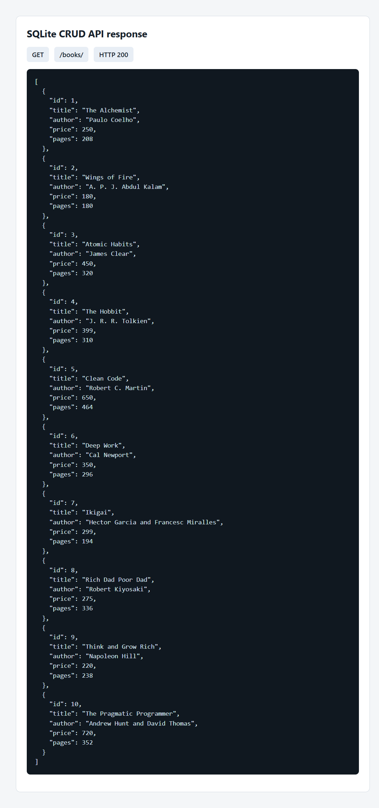
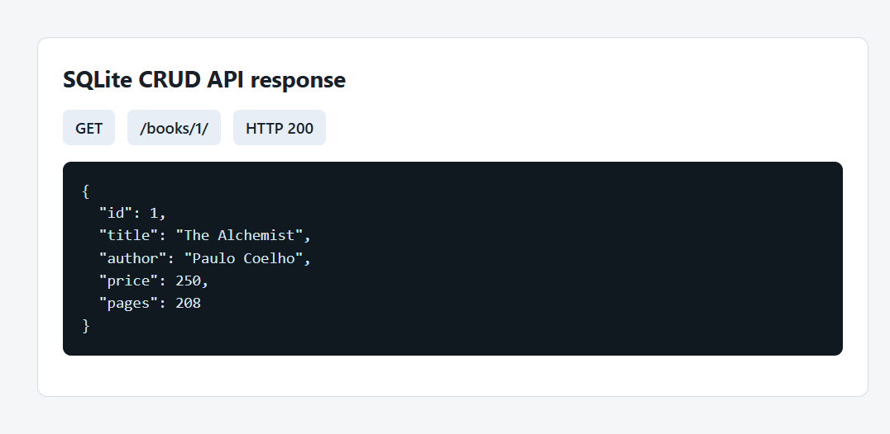
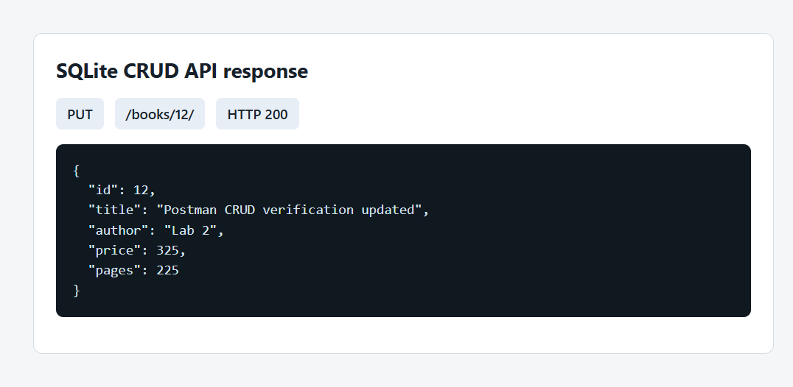
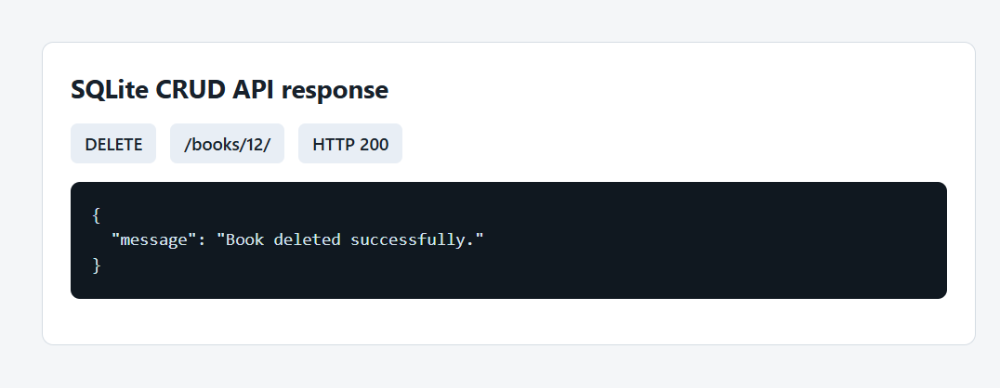
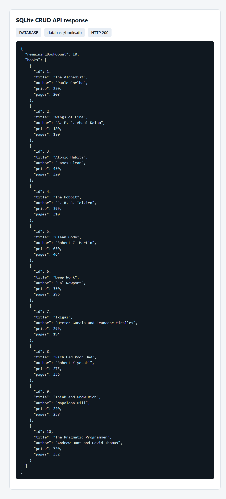

# Lab 2: SQLite database and CRUD routes

**Name:** M.K.YOGESH<br>
**Registration number:** 252U1R9085<br>
**Section:** CSE GEN AI 2B

**Live API:** https://bdf-lab-2-sqlite-crud.onrender.com<br>
**Books endpoint:** https://bdf-lab-2-sqlite-crud.onrender.com/books/

## How to run

Requirements: Node.js LTS and npm.

```powershell
npm install
Copy-Item .env.example .env
npm run seed
npm start
```

The server listens on the configured port (defaults to `3000`). Optional environment variables are:

| Variable | Description |
|---|---|
| `PORT` | HTTP port |
| `DB_PATH` | SQLite database file path, relative to this project folder |

Do not commit `.env`; `.env.example` contains only non-secret defaults. `npm run dev` starts the server with nodemon during development.

## Render deployment

The repository includes a Render Blueprint at [`../render.yaml`](../render.yaml). It creates a free Node.js web service from this folder, starts the API, and checks `/books/` for health. The deployed service has been verified with all five endpoints. Free Render services use an ephemeral filesystem: SQLite changes work while the instance is running, but are lost when the service restarts, spins down, or redeploys. Render persistent disks require a paid web-service plan and are not enabled here.

## Endpoints

Base URL: `http://localhost:<PORT>`

| Method | Path | Description |
|---|---|---|
| GET | `/books/` | Return all books. |
| GET | `/books/:bookId/` | Return one book by ID. |
| POST | `/books/` | Create a book and return it with its generated ID (`201`). |
| PUT | `/books/:bookId/` | Replace all editable fields of an existing book (`200`). |
| DELETE | `/books/:bookId/` | Delete a book by ID (`200`). |

POST and PUT require a JSON body with `title`, `author`, `price` (non-negative integer), and `pages` (positive integer). Values are bound with SQLite placeholders rather than concatenated into SQL. Invalid input returns `400`; a missing book returns `404`.

Import [`postman/Lab_02_SQLite_CRUD.postman_collection.json`](postman/Lab_02_SQLite_CRUD.postman_collection.json) into Postman and set `baseUrl` to the running server URL.

## Screenshots

These screenshots show successful responses from the running API and the database state after the CRUD sequence. They were captured from a browser-based HTTP check because the Postman desktop app is not installed in this environment. Import the collection above to reproduce the requests in Postman if Postman-UI screenshots are specifically required.












## Notes

- The SQLite database is `database/books.db`. `npm run seed` creates the table and inserts ten sample books only when the table is empty.
- The seed command resolves `DB_PATH` relative to the project root, matching the API server configuration.
- POST creates a new resource; PUT replaces the editable fields of the resource identified by the URL.
- Awaiting database calls ensures each response is sent only after the operation has completed and its result is known.
- SQL injection occurs when untrusted input is interpreted as part of SQL syntax. Placeholders bind values as data, not executable SQL.
