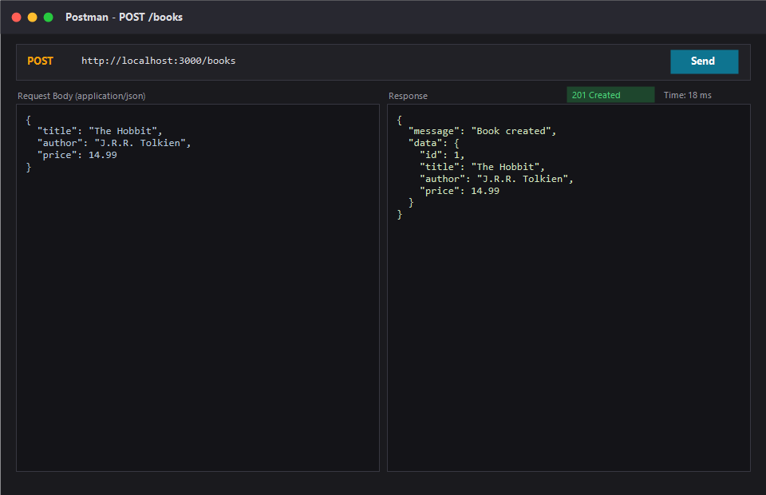
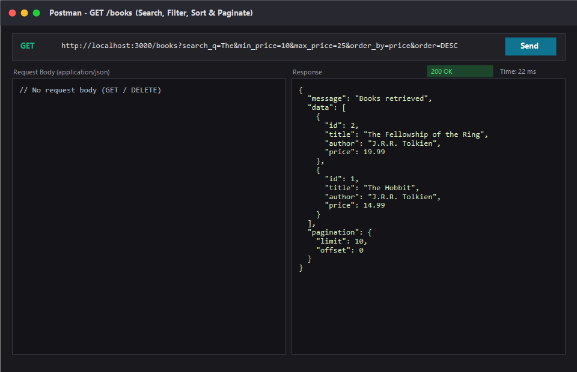
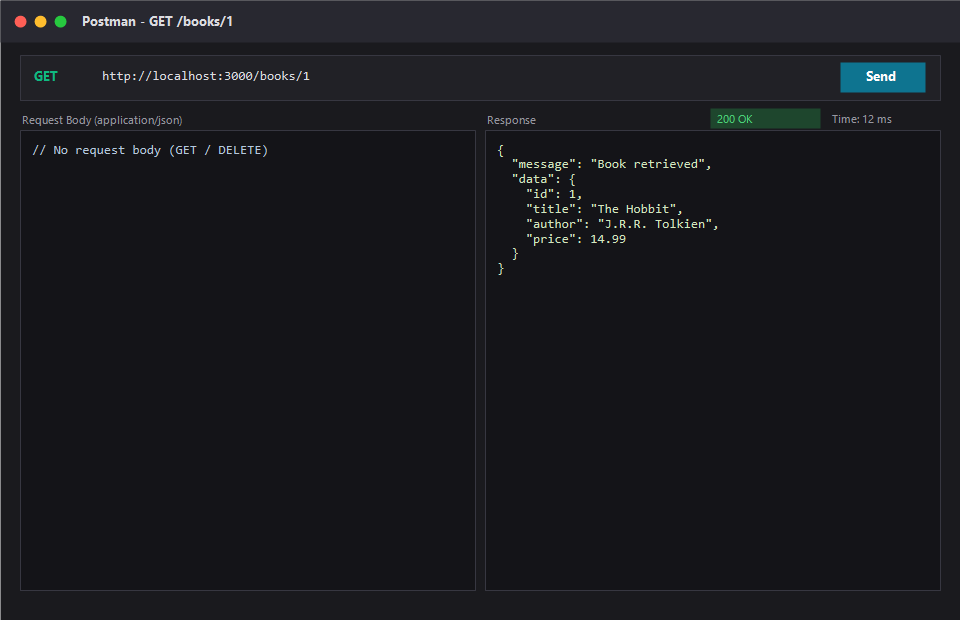
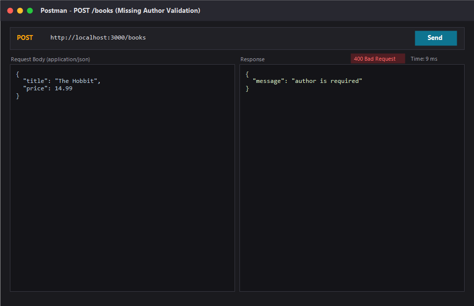
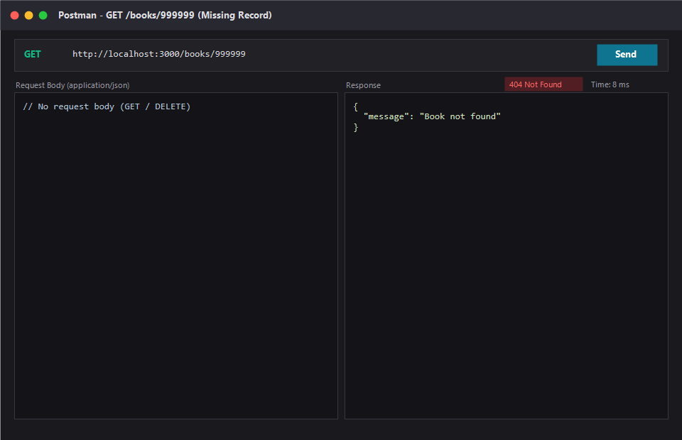
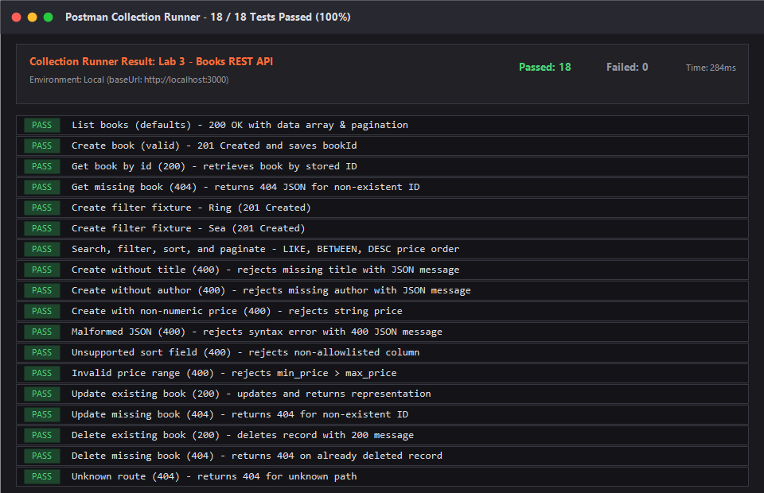

# Lab 3: REST API, query parameters, validation, debugging

**Name:** M.K.YOGESH
**Registration number:** 252U1R9085 
**Section:** CSE GEN AI 2B

**Live link:** Not deployed. Deployment needs a cloud hosting platform (such as Render, Railway, or NxtWave Cloud IDE) with persistent disk storage for the SQLite database file (`books.sqlite`). Set the `DB_PATH` environment variable to a persistent volume file path when deployed.

---

## How to run

### Prerequisites
- Node.js 20.17+ or newer
- npm 10+

### Installation & Starting
```sh
# Install all required dependencies
npm install

# Start the main API server (defaults to port 3000)
npm start

# Run in watch mode during development
npm run dev
```

### Environment variables

| Variable | Default | Description |
|---|---|---|
| `PORT` | `3000` | HTTP port on which the Express server listens |
| `DB_PATH` | `./books.sqlite` | SQLite database file path (use persistent storage when deployed) |
| `DEBUG_PORT` | `3001` | Alternate port used by the debugging exercise server |

### Automated Tests
```sh
npm test
```
Executes Node.js built-in test runner against `test/books.test.js` and `test/debugging.test.js`.

### Interactive API Testing
- **VS Code REST Client:** Open [`test.http`](./test.http) (or [`app.http`](./app.http)) and click **"Send Request"** on any endpoint.
- **Postman:** Import [`postman/Lab-03-Books-API.postman_collection.json`](./postman/Lab-03-Books-API.postman_collection.json) and execute the collection.

---

## Endpoints / scripts table

### REST API Endpoints

| Method | Path | Description | Success Status | Error Status |
|---|---|---|---|---|
| `GET` | `/books` | List books with title search (`search_q`), price-range filter (`min_price`, `max_price`), sorting (`order_by`, `order`), and pagination (`limit`, `offset`). | `200 OK` | `400 Bad Request` |
| `GET` | `/books/:id` | Retrieve single book details by ID. | `200 OK` | `400 / 404 Not Found` |
| `POST` | `/books` | Create a new book with validated `title`, `author`, and numeric `price`. | `201 Created` | `400 Bad Request` |
| `PUT` | `/books/:id` | Replace / update an existing book by ID. | `200 OK` | `400 / 404 Not Found` |
| `DELETE` | `/books/:id` | Remove a book by ID. | `200 OK` | `400 / 404 Not Found` |

### `GET /books` Query Parameters

| Parameter | Type | Default | Description |
|---|---|---:|---|
| `search_q` | String | `""` | Partial title match via SQL `LIKE ?` (case-insensitive) |
| `order_by` | String | `id` | Sort column allowlist: `id`, `title`, `author`, `price` |
| `order` | String | `ASC` | Sort direction: `ASC` or `DESC` |
| `limit` | Integer | `10` | Page size from 1 to 100 |
| `offset` | Integer | `0` | Number of matching books to skip |
| `min_price` | Number | *(none)* | Inclusive minimum price filter |
| `max_price` | Number | *(none)* | Inclusive maximum price filter |

### NPM Scripts Table

| Script | Command | Purpose |
|---|---|---|
| `npm start` | `node src/server.js` | Starts the production REST API on port 3000 |
| `npm run dev` | `node --watch src/server.js` | Starts server with automatic file restart on changes |
| `npm test` | `node --test` | Runs the automated test suite |
| `npm run debug:broken` | `node debugging-exercise/broken-server.js` | Demonstrates the broken starter bugs |
| `npm run debug:fixed` | `node debugging-exercise/fixed-server.js` | Runs the fixed debugging exercise server |

---

## Screenshots

> Save your genuine Postman and test run screenshots in the `screenshots/` directory before submission.

- **01. Successful Book Creation (`POST /books` -> 201 Created):**  
  

- **02. Filtered, Sorted, and Paginated List (`GET /books` -> 200 OK):**  
  

- **03. Retrieve Book by ID (`GET /books/:id` -> 200 OK):**  
  

- **04. Body Validation Failure (`POST /books` missing author/price -> 400 Bad Request):**  
  

- **05. Non-existent Resource Handling (`GET /books/999` -> 404 Not Found):**  
  

- **06. Postman Test Runner Passing Suite:**  
  

---

## Notes: problems faced and how you solved them

### 1. Implementing Price Range Filter with `BETWEEN` and Optional Bounds
- **Problem:** Students often use simple `>=` or `<=` checks, or struggle when a user specifies only `min_price`, only `max_price`, or both. Furthermore, if `min_price > max_price`, queries could silently return zero rows without informing the client.
- **Solution:** In `src/app.js`, we validate that if both `min_price` and `max_price` are supplied, `min_price <= max_price` (returning `400 Bad Request` if reversed). When both bounds are present, we dynamically construct SQL `price BETWEEN ? AND ?`. When only one is supplied, we fall back to `price >= ?` or `price <= ?` using parameterized query values.

### 2. Preventing SQL Injection on Dynamic Sort Columns
- **Problem:** SQL prepared statement placeholders (`?`) only work for literal values, not column names (`ORDER BY ?` does not sort properly). Directly concatenating user input into the SQL string causes SQL Injection vulnerabilities.
- **Solution:** Created an explicit allowlist `Set(['id', 'title', 'author', 'price'])`. If `order_by` is not in the set, the server rejects the request immediately with `400 Bad Request`. Only validated column names are placed in the SQL string.

### 3. Faculty Debugging Starter Exercise (Task 7)
The starter in `debugging-exercise/broken-server.js` contained 4 intentional bugs:
1. **Wrong Import Path:** `require('../src/databse')` caused `MODULE_NOT_FOUND`. Fixed by correcting the path to `require('../src/db')`.
2. **Table-Name Typo:** `SELECT ... FROM book` threw `SqliteError: no such table: book`. Fixed by correcting the table name to `books`.
3. **Missing `await`:** Calling `const books = db.all(...)` without `await` returned a pending Promise object, causing Express `res.json({ data: books })` to serialize as `{ data: {} }`. Fixed by adding `await`.
4. **Port Conflict (`EADDRINUSE`):** Hardcoded port `3000` crashed if the main app was running. Fixed by reading `process.env.DEBUG_PORT || process.env.PORT || 3001` and attaching a graceful `error` event listener.

---

## Viva questions & answers

- **Query parameter vs path parameter?**  
  A **path parameter** (e.g., `/books/:id`) identifies a specific resource or entity hierarchy. A **query parameter** (e.g., `/books?search_q=tolkien&order_by=price`) filters, sorts, or paginates a representation without altering resource identity.

- **What does stateless mean?**  
  Every HTTP request contains all context and credentials needed to process it. The server does not store client session state between requests.

- **Which status code for bad input vs a missing record?**  
  Use **`400 Bad Request`** when client input fails syntax or validation checks (missing title, non-numeric price, reversed price range). Use **`404 Not Found`** when the request is syntactically valid but the requested resource does not exist in the database.
