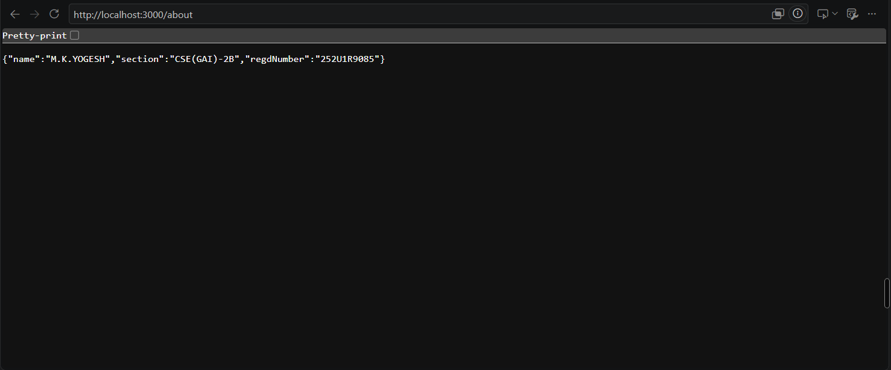
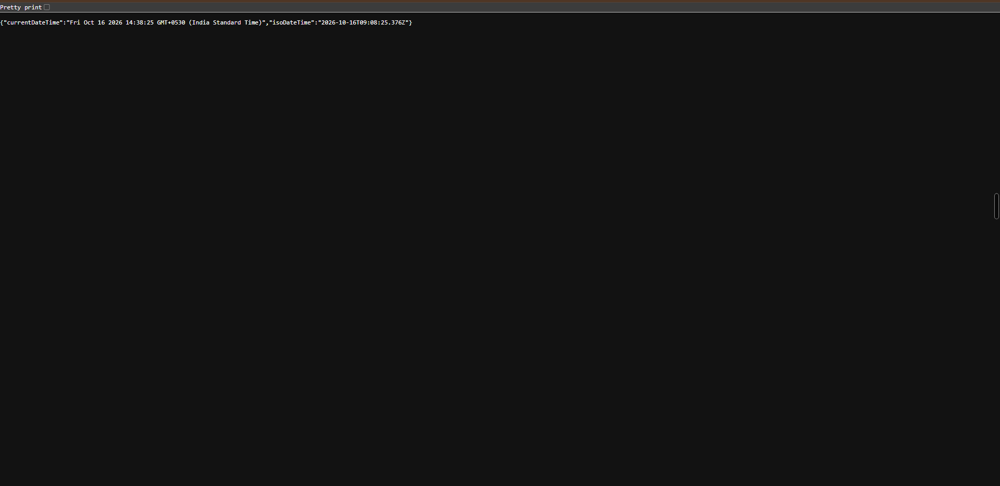
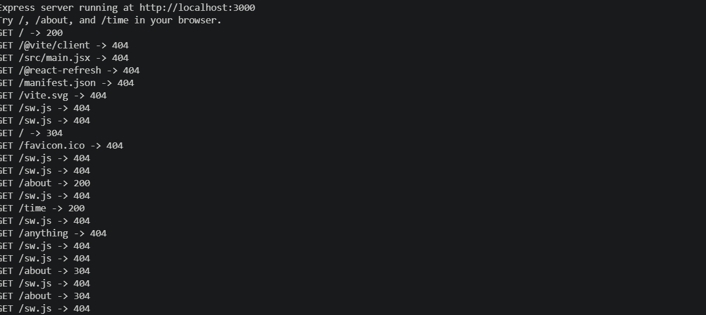

# Lab 1: Node.js and Express server

**Course:** Backend Development Fundamentals  
**Name:** M.K.YOGESH  
**Registration number:** 252U1R9085  
**Section:** CSE(GAI)-2B

## Live link

Add Yogesh's Render URL here after deployment.

## Objective

Set up a Node.js project, create a small server using Node.js's built-in `http` module, and then implement a server using Express.

## Requirements

- Node.js and npm installed.
- VS Code or another code editor.
- A browser for checking the routes.

Check your installation in the VS Code terminal:

```bash
node --version
npm --version
```

## Project structure

```text
lab-01/
├── screenshots/
│   ├── home.png
│   ├── about.png
│   ├── time.png
│   ├── not-found.png
│   └── terminal-status-codes.png
├── .gitignore
├── package-lock.json
├── package.json
├── server-http.js
├── server.js
└── README.md
```

## Setup and run

1. Open the `lab-01` folder in VS Code.
2. Open **Terminal → New Terminal**.
3. Install the dependencies:

   ```bash
   npm install
   ```

4. Start the Express server:

   ```bash
   npm start
   ```

5. Open these URLs in your browser:

   - `http://localhost:3000/`
   - `http://localhost:3000/about`
   - `http://localhost:3000/time`
   - `http://localhost:3000/anything`

6. To run the plain Node.js HTTP server, stop the Express server using `Ctrl + C` and run:

   ```bash
   npm run start:http
   ```

   Open `http://localhost:3001/` to see `Hello`.

## Endpoints

| Server | Method | Path | Description | Expected status |
|---|---|---|---|---:|
| Express | GET | `/` | Returns a welcome message | 200 |
| Express | GET | `/about` | Returns student details in JSON | 200 |
| Express | GET | `/time` | Returns the current date and time | 200 |
| Express | GET | Any unknown path | Returns a page-not-found message | 404 |
| Built-in HTTP | GET | `/` | Returns `Hello` | 200 |
| Built-in HTTP | GET | Any unknown path | Returns a page-not-found message | 404 |

## Expected output

### Home route

```text
Welcome to my Node.js and Express server!
```

### About route

```json
{
  "name": "M.K.YOGESH",
  "section": "CSE(GAI)-2B",
  "regdNumber": "252U1R9085"
}
```

### Time route

The `/time` endpoint returns JSON containing `currentDateTime` and `isoDateTime`. The values change whenever the endpoint is requested.

### Unknown route

```text
404 - Page not found
```

The terminal displays the request method, path, and response status code.

## What is in `package.json`?

- `name`: Project name.
- `version`: Project version.
- `description`: Short description of the project.
- `main`: Main entry file.
- `scripts`: Commands used to start the servers.
- `keywords`: Searchable terms related to the project.
- `author`: Project author.
- `license`: Project license.
- `dependencies`: Packages required by the application.

## `package.json` vs `node_modules`

`package.json` stores project information, scripts, and dependency details. The `node_modules` directory contains the installed packages.

Dependencies can be installed using `npm install`. The `node_modules` directory should not be committed to GitHub.

## Screenshots

After Yogesh runs the project, add his own screenshots with these names:

### Home route


### About route



### Time route



### 404 route


### Terminal status codes



## Viva preparation

**1. What is the difference between `package.json` and `node_modules`?**

`package.json` contains project information and dependency details, while `node_modules` contains the installed packages.

**2. What does `app.listen()` do?**

It starts the Express server and listens for incoming requests on the specified port.

**3. What do request and response represent?**

The request object contains information about an incoming HTTP request. The response object is used to send data and status codes back to the client.

**4. What is HTTP status code 404?**

It indicates that the requested route or resource was not found.

**5. What is a route?**

A route connects an HTTP method and URL path to the code that handles the request.

## GitHub submission

Run the following commands from the project folder after Yogesh creates an empty GitHub repository:

```bash
git init
git add .
git commit -m "Complete BDF Lab 01"
git branch -M main
git remote add origin https://github.com/M-K-yogesh/BDF-Labs.git
git push -u origin main
```

The repository should be public or shared with the faculty. Do not commit `node_modules` or `.env`.

## Deployment

Deploy the project through Yogesh's Render account using `npm install` as the build command and `npm start` as the start command.

**Live URL:** Add Yogesh's deployed Render URL here.

The following endpoints should be tested:

- `/` – Displays the welcome message.
- `/about` – Returns Yogesh's student details in JSON format.
- `/time` – Returns the current server date and time.
- `/anything` – Returns a 404 Page Not Found response for unknown routes.

## Notes / problems faced

The Express server was started using `npm start`. The home, about, time, and unknown routes were tested in the browser. The terminal displayed the corresponding HTTP status codes.
